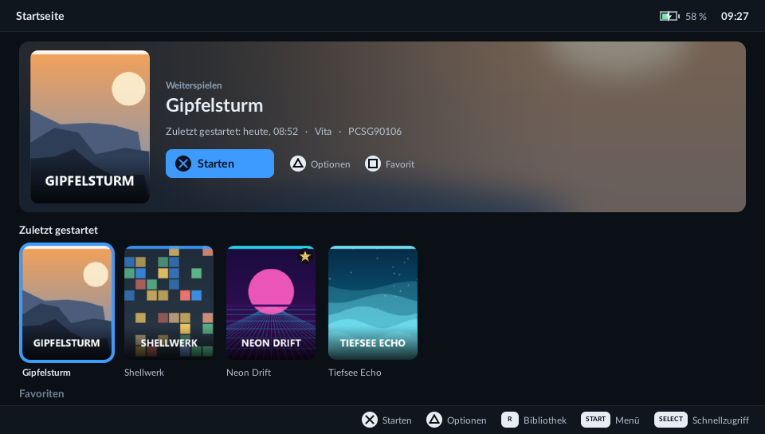
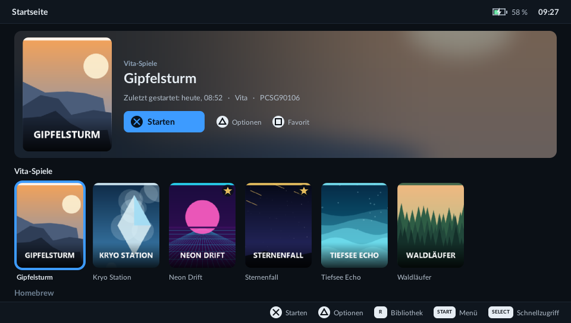
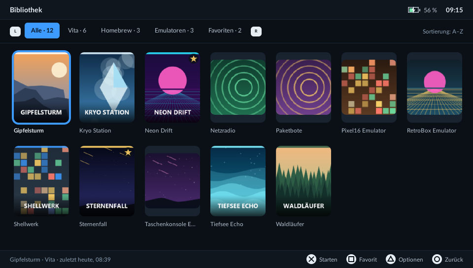
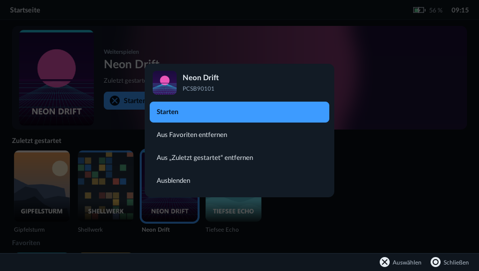
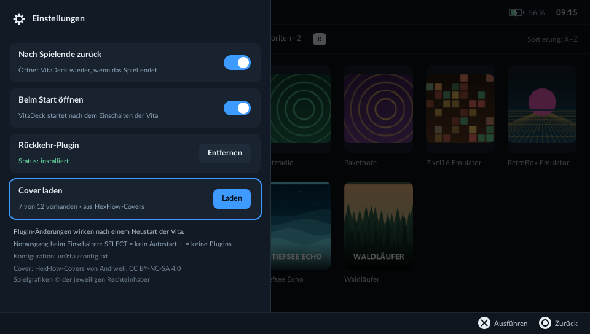
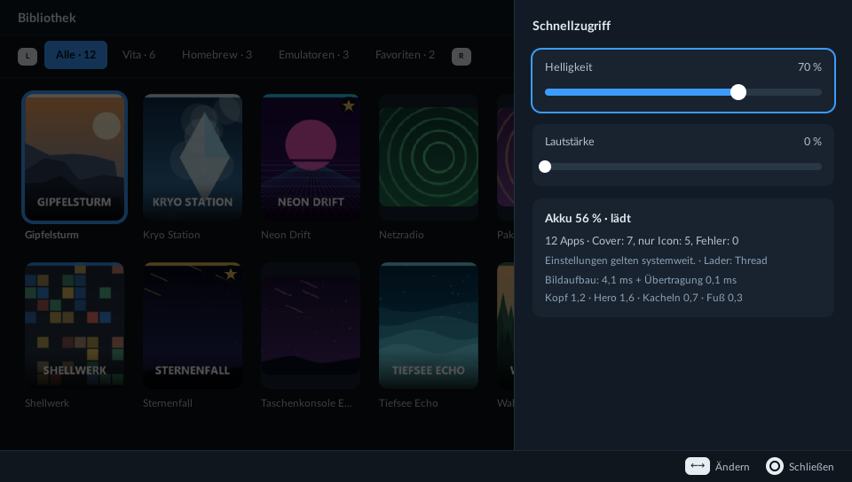

<p align="center">
  <picture>
    <source media="(prefers-color-scheme: dark)" srcset="docs/logo-wordmark-dark.png">
    
  </picture>
</p>

# VitaDeck v0.3

A console-style home screen launcher for the PS Vita (HENkaku/Ensō or h-encore), inspired by SteamOS – without any third-party branding.
Plain C with a software renderer. The user interface is in German.
Fonts: Lato (UI) and Space Grotesk (wordmark), both under the SIL Open Font License (`res/OFL-*.txt`).

## Screenshots
| | |
|---|---|
|  |  |
| Home: box art in the hero, blurred background from the cover | Portrait box art tiles, rows by category |
|  |  |
| Library: box art, apps without a cover show their icon | Options (△): favourite, hide |
|  |  |
| Settings: return plugin and **cover download** | Quick access (SELECT) |

<sub>Captured in the Vita3K emulator with a demo set: all titles and covers are made up and generated (`docs/demo/`). On a real Vita, "Cover laden" fetches the real box art from HexFlow-Covers.</sub>

## Requirements
- A PS Vita with HENkaku/Ensō or h-encore and VitaShell
- Tested on firmware 3.65 with Ensō; other firmwares supported by HENkaku/h-encore should work but are untested

## Installation
1. Download `VitaDeck.vpk` from the [latest release](https://github.com/LuckyISlevin/VitaDeck/releases/latest) and copy it to `ux0:` with VitaShell (FTP or USB).
2. In VitaShell, open the VPK → install. VitaDeck is an "unsafe" homebrew, so confirm the extended-permissions prompt with ✕.
3. Start the "VitaDeck" bubble from the LiveArea.

Uninstall like any other app from the LiveArea (hold the bubble → delete).
Saved data (favourites, recently played, hidden apps, brightness): `ux0:data/VitaDeck/state.txt`.
Data from v0.1 (`ux0:data/VitaLauncher/`) is picked up on first start.
All versions share the title ID `VLAUNCH01` and install as an update over the previous one; favourites and history are kept.

## Controls
| Button | Home | Library |
|---|---|---|
| D-pad / left stick | navigate | navigate |
| ✕ | start app | start app |
| □ | toggle favourite | toggle favourite |
| △ | options | options (incl. sorting) |
| L / R | go to library | switch category |
| ○ | – | back to home |
| START | main menu | main menu |
| SELECT | quick access | quick access |

Touch: tap a tile to select it, tap again to start. The button hints in the footer can be tapped too.

## Features
- Reads all apps from `ux0:app` (title from `param.sfo`, icon from `ur0:appmeta/<ID>/icon0.png`)
- Sorts them into Vita games (title ID `PCSxxxxxx`), homebrew and emulators (by name)
- Home screen with a large hero area and rows: recently played, favourites, Vita games, homebrew, emulators
- **Box art:** portrait cover tiles and a cover in the hero, with a blurred, darkened background made from the cover.
  Settings → "Cover laden" downloads the box art of all installed apps over HTTPS from
  [HexFlow-Covers](https://github.com/andiweli/hexflow-covers) (the database also used by HexFlow and RetroFlow) to
  `ux0:data/VitaDeck/covers/box/<TITLE-ID>.png`; existing files are kept, so you can also put your own 250×320 PNGs there.
  Wi-Fi is required. Apps without box art show their icon. Images are decoded on a background thread and preloaded while the UI is idle.
- Library with categories and sorting (A–Z / recently played, via △ options)
- Hide apps: △ → "Ausblenden"; hidden apps appear in the library tab "Ausgeblendet" (only shown when not empty) and can be restored there via △ → "Einblenden"
- Launches via `sceAppMgrLaunchAppByUri("psgm:play?titleid=…")`; the launcher exits while the game runs. If a launch fails, VitaDeck stays open and shows the error code.
- Main menu: home, library, reload app list, settings, standby, restart, quit launcher
- Quick access: brightness, volume (system-wide via SceAVConfig), battery, render-time diagnostics
- **Return plugin** (Settings → "Rückkehr-Plugin" → install): a small taiHEN user plugin for the system shell.
  It starts VitaDeck after boot and reopens it when a game started from VitaDeck is closed
  (games started from the LiveArea are left alone). Both can be switched off separately; the return switch applies immediately, autostart on the next boot.
  Installing copies `vdreturn.suprx` to `ur0:tai/` and adds it under `*main` in the config.txt taiHEN uses (backup: `config.txt.vitadeck.bak`).
  Escape hatches: hold SELECT while powering on = no autostart; hold L while powering on = taiHEN loads no plugins at all.
  Log: `ux0:data/VitaDeck/plugin.log`.
  > **Note:** installing the plugin edits your taiHEN `config.txt`. VitaDeck asks first, keeps a backup next to it and verifies the result, but as with any plugin: if something goes wrong, boot while holding L and restore `config.txt` from `config.txt.vitadeck.bak` in VitaShell. The plugin is optional – VitaDeck works without it.

## What's new in v0.3
- Tested on real hardware; smooth thanks to render caches, a present thread on its own CPU core and 444 MHz (~12 ms per frame)
- Hero area one third taller, with a background image per app (pic0/LiveArea or your own), preloaded in the background
- Hide/unhide apps, library tab "Ausgeblendet"; △ opens the options in the library too
- Settings with the return plugin: autostart after boot and return after a game, installable from within VitaDeck
- Larger fonts, error message with code when a game fails to start

## What's new in v0.2
- New name VitaDeck, logo "focus grid with start tile" (concept 3E) on the boot screen, menu, bubble and LiveArea
- Wordmark in Space Grotesk, fonts reduced to Latin characters (VPK ~260 KB instead of 800 KB)

## Roadmap
Planned features and ideas (in German): [docs/ROADMAP.md](docs/ROADMAP.md).
Not included: launching PSP ISOs through Adrenaline (`ux0:pspemu`).

## Building
**Windows (recommended):** extract the native VitaSDK toolchain to `C:\vitasdk`
(`vitasdk-x86_64-w64-mingw32-*.tar.bz2` from github.com/vitasdk/autobuilds, release `sdk-snapshot-…`, not `softfp`).
Then run `.\build.ps1` (or `.\build.ps1 -Clean`) in the project folder → `build-win\VitaDeck.vpk`, including the return plugin.
No cmake, make or WSL needed; set `$env:VITASDK` for a different SDK path.

**Alternative A – without the VitaSDK installer:**
arm-none-eabi-gcc + newlib, tools from `vitasdk/vita-toolchain`, stub libraries from `vitasdk/vita-headers`
(`vita-libs-gen-2 -yml=db` + `make`), with the project's own startup code (`src/crt.c`) and linker script (`vita.ld`).
Adjust the paths at the top of the `Makefile`, then run `make`.

**Alternative B – regular VitaSDK (Linux/WSL):**
```
export VITASDK=/usr/local/vitasdk
mkdir build-sdk && cd build-sdk
cmake .. && make
```
This uses VitaSDK's own crt0/newlib (`src/crt.c` and `vita.ld` are not used).
Note: the Makefile and CMake builds do not build or package the return plugin yet – use `build.ps1` for that.

`make host` builds a Linux version that renders screenshots of the UI (`host/`).

## License
VitaDeck is released under the [MIT License](LICENSE).
Bundled third-party components keep their own licenses: Lato and Space Grotesk (SIL Open Font License 1.1, `res/OFL-*.txt`),
the stb libraries by Sean Barrett (public domain / MIT), the Mozilla CA bundle `res/cacert.pem` (MPL-2.0), and the statically
linked libcurl, mbedTLS, zlib and zstd (see [LICENSE](LICENSE)).

**Box art:** VitaDeck ships no covers. "Cover laden" downloads them on your device from
[HexFlow-Covers](https://github.com/andiweli/hexflow-covers) by Andiweli and contributors, licensed under
[CC BY-NC-SA 4.0](https://creativecommons.org/licenses/by-nc-sa/4.0/); the cover artwork itself remains © its respective publishers.

VitaDeck is an unofficial homebrew project and is not affiliated with Sony Interactive Entertainment or Valve.
